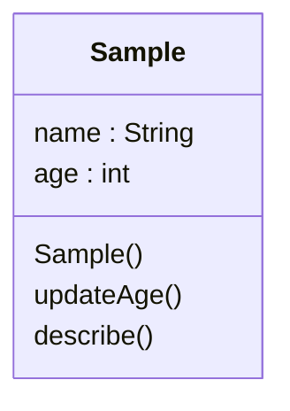

# Caretta ソースコード解説

## クラス図



## Sample.java (Java)

### class Sample

サンプル利用者のプロフィール情報を管理する。

#### クラス変数・フィールド

| 名前 | 区分 | 型 | 初期値 | 説明 |
|---|---|---|---|---|
| name | フィールド | {_cell(member.type_name or '不明')} | なし | {_cell(member.description or '説明コメントはありません。')} |
| age | フィールド | {_cell(member.type_name or '不明')} | なし | {_cell(member.description or '説明コメントはありません。')} |

#### クラスメソッド

##### `Sample`

```text
public Sample(String name, int age)
```

名前と年齢を指定してプロフィールを作成する。

@param name 利用者の表示名
@param age 利用者の年齢

**参照するメンバー変数:** `age`, `name`

**処理実装:**

```text
{
        this.name = name;
        this.age = age;
    }
```

##### `updateAge`

```text
public void updateAge(int age)
```

利用者の年齢を更新する。

@param age 更新後の年齢

**参照するメンバー変数:** `age`

**処理実装:**

```text
{
        this.age = age;
    }
```

##### `describe`

```text
public String describe()
```

利用者の表示名と年齢を返す。

@return プロフィールの説明

**参照するメンバー変数:** `age`, `name`

**処理実装:**

```text
{
        return name + " (" + age + ")";
    }
```
